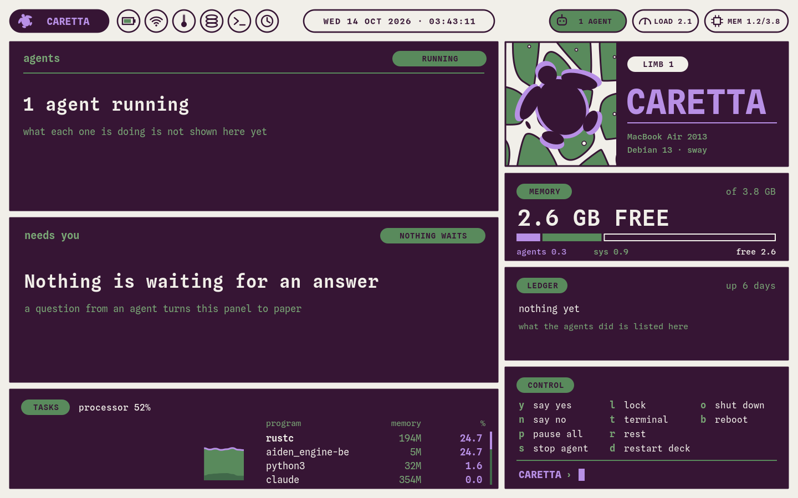
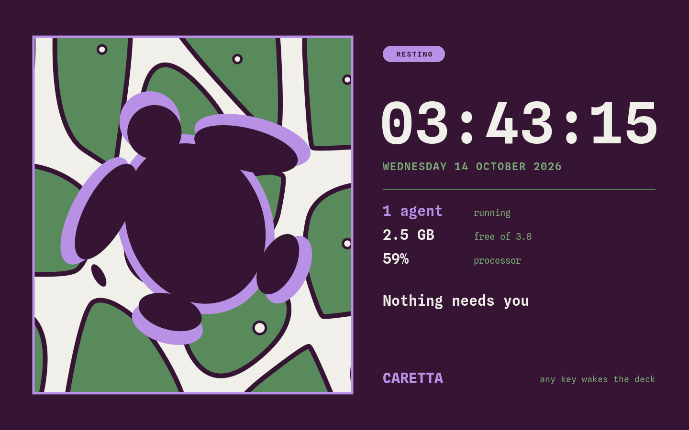
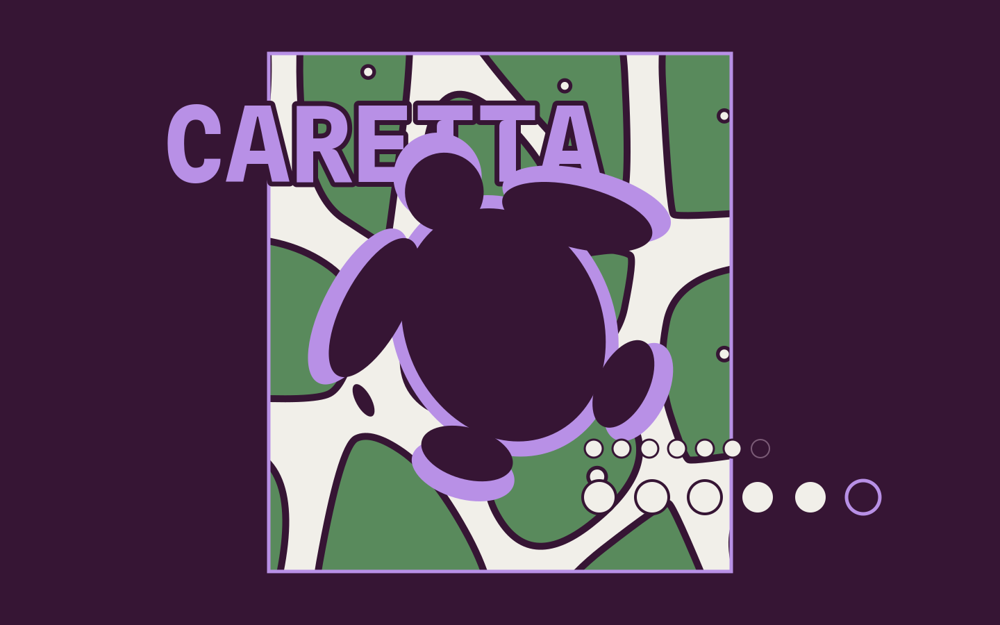
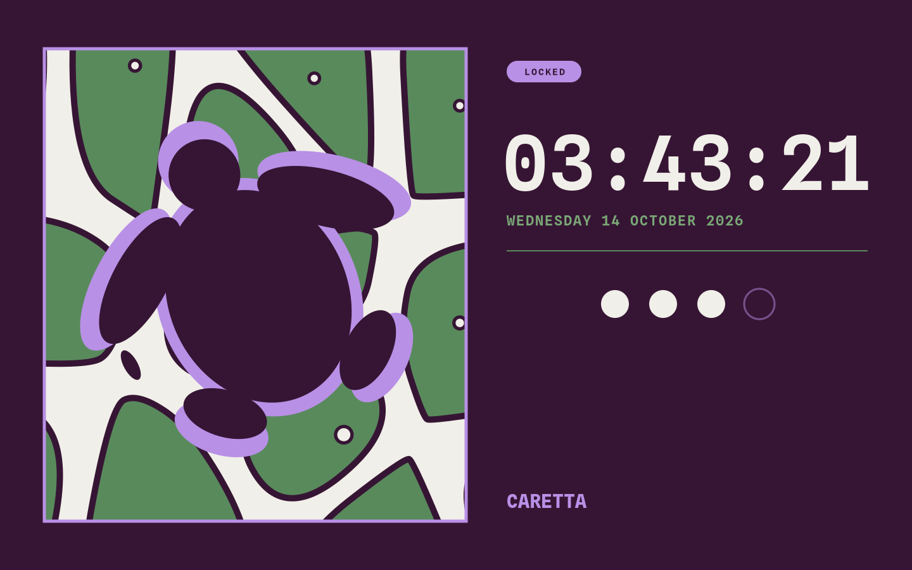
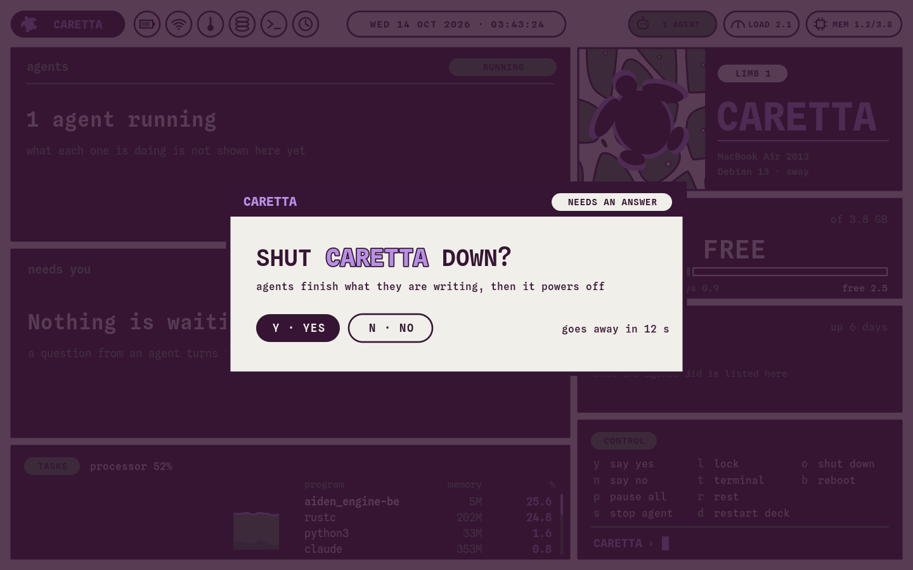

# Caretta rice

A full-screen deck, a login, a lock and a resting screen for a small machine that is always on and mostly
watched from across the room. Built for a 2013 MacBook Air running Debian 13 with no desktop; nothing in it is tied to that model. Flat colour,
thick outlines, a sea turtle, one typeface. No bar, no workspaces, no window decorations: one program draws
the whole screen and sway only holds it.

It was made for one machine of [Kimera](https://github.com/burakTanBilgi/Kimera), a project that puts idle
computers to work. The look stands on its own; nothing here needs Kimera.

## Screens

Every picture is drawn by the deck's own program on the machine (`caretta-deck-panel --png`), at the Air's
1440 x 900.

| | |
|---|---|
|  | **The deck.** Agents, what waits for an answer, memory, the busiest programs, and the keys. |
|  | **Resting.** What the screen shows when nobody is at it. Any key wakes the deck. |
|  | **Login.** The face of greetd. The name is typed as small bubbles, then the password as large ones. |
|  | **Locked.** `l` on the deck. The system's own password check answers; nothing is stored. |
|  | **A question.** Shutting down asks first and goes away by itself after a few seconds. |

## What is here

| Path | What it is |
|---|---|
| `deck/caretta-deck-panel` | The program: deck, rest, lock and login in one file (Python, GTK 3, cairo). |
| `deck/*.svg`, `deck/*.png` | The artwork, as drawn (SVG) and as the program loads it (PNG). |
| `deck/deck.sway`, `deck/greeter.sway` | sway holds one window and nothing else. |
| `deck/deck-install.sh` | Installs the program, the art, the font, the sway files and greetd's login. |
| `deck/kimera-deck` | Starts the deck from a text login. |
| `deck-packages.sh` | The desktop pieces from Debian: sway, a terminal (foot), and, for the machine's own use, Firefox ESR, a file manager (Thunar), a launcher (wmenu), btop, a screenshot tool and Noto fonts. Trim the list to taste; the deck itself needs only sway. |
| `awake-install.sh` | The machine never sleeps and the console never blanks, lid closed or not. (The deck itself dims the backlight after five minutes without a key.) Its header says how to undo it. |
| `deck/kimera-poweroff`, `deck/poweroff-install.sh` | One user may power the machine off or restart it without sudo, and nothing else. The deck's installer runs it. |

## Install

On a fresh Debian 13 with no desktop, with sudo from your own user, from this folder:

```sh
sudo sh deck-packages.sh
sudo sh awake-install.sh
sudo sh deck/deck-install.sh
```

Read each script first; they are short and say what they change. Things to know before you run them:

- `deck-packages.sh` adds the first user (uid 1000) to the groups `video`, `render` and `input`, and
  `deck/deck-install.sh` adds greetd's login user to the same. A member of `input` can read every key pressed
  on the machine; sway needs it when started without a seat manager.
- `deck/deck-install.sh` replaces `/etc/greetd/config.toml` (the old one is kept as `config.toml.debian`) and
  starts greetd on screen 7 at boot. It assumes no other login manager. Before switching it on it only tests
  that the login picture can be drawn as greetd's user; if screen 7 stays dark at boot, the text login is on
  Ctrl+Alt+F2.
- It also removes `modemmanager` and `mesa-vulkan-drivers` when nothing else would go with them, and clears
  apt's download cache.
- It runs `deck/poweroff-install.sh`, which lets your user power off and restart without a password, over ssh
  too. That needs polkit (`apt install polkitd`).
- `awake-install.sh` is for a machine that stays plugged in on a desk: a laptop that cannot sleep gets hot in a
  bag. It masks the sleep targets, writes one file under `/etc/systemd/logind.conf.d` and takes the console
  blanking setting out of grub (keeping `/etc/default/grub.before-awake`); the undo is in its header.
- **The lock is the deck's own.** It asks the system for your password, but it locks that one window: the other
  consoles (Ctrl+Alt+F2) and ssh are not locked by it.
- The deck takes the keyboard layout from `/etc/default/keyboard`. The badge, the machine line and the program
  counted as an agent are three settings at the top of `deck/caretta-deck-panel` (`KIMERA_BADGE`,
  `KIMERA_MACHINE`, `KIMERA_AGENT`).

## Keys on the deck

`l` lock, `t` a terminal, `r` rest, `d` restart the deck, `o` shut down, `b` reboot (both ask first, `y` or
`n`). `y` `n` `p` `s` are also meant for agents (answer a question, pause all, stop one); on its own the deck
only says that no agent is asking.

## Fonts and licences

- Scripts and programs: [MIT](LICENSE).
- The artwork (`deck/*.svg`, `deck/*.png`, `screens/`): [CC BY 4.0](LICENSE-ART.md).
- Spline Sans Mono, in `deck/fonts/`: SIL Open Font License, its text is beside it.

Designed and directed by Burak Tan Bilgi. Built and tested with AI coding agents. Results reviewed by him.
